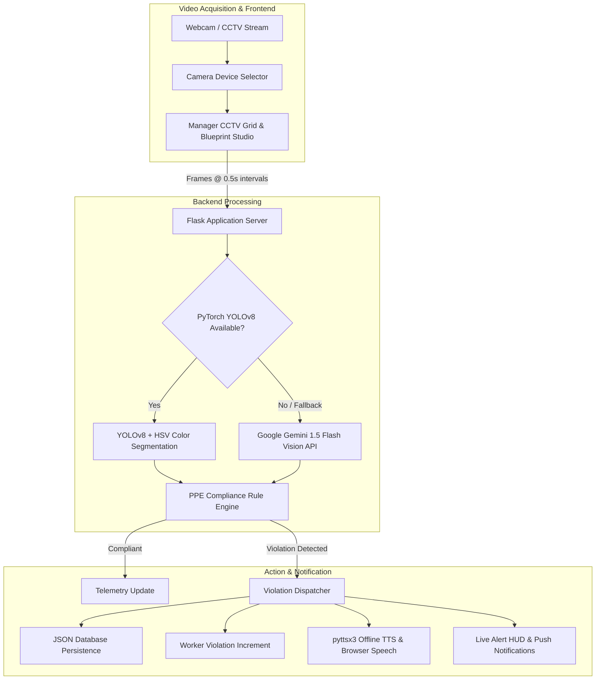

# 🏗️ SafCam Enterprise - AI Construction Site Safety & Command Center

[](https://www.python.org/)
[](https://flask.palletsprojects.com/)
[](https://github.com/ultralytics/ultralytics)
[](https://ai.google.dev/)
[](LICENSE)

**SafCam** is an enterprise-grade, real-time computer vision safety monitoring and command center platform built for construction sites, industrial facilities, and engineering plants. Powered by a **hybrid detection engine** combining local deep learning (**PyTorch YOLOv8**) with cloud-based **Google Gemini 1.5 Flash Vision**, SafCam automates Personal Protective Equipment (PPE) compliance monitoring, site blueprint management, safety sector configuration, workforce clearance tracking, and emergency broadcasting.

---

## 📑 Table of Contents

- [Key Features](#-key-features)
- [System Architecture](#-system-architecture)
- [Prerequisites](#-prerequisites)
- [Quick Start Installation](#-quick-start-installation)
- [Configuration](#-configuration)
- [Running SafCam](#-running-safcam)
- [Dashboards & Portals](#-dashboards--portals)
  - [1. Single-Feed Live Optical Monitor](#1-single-feed-live-optical-monitor)
  - [2. Enterprise Manager Command Center](#2-enterprise-manager-command-center)
- [Detection Modes & Calibrations](#-detection-modes--calibrations)
- [REST API Reference](#-rest-api-reference)
- [Project Directory Structure](#-project-directory-structure)
- [Troubleshooting](#-troubleshooting)
- [License](#-license)

---

## 🎯 Key Features

- ⚡ **Real-Time Optical PPE Detection** – Analyzes video frames every **0.5 seconds** with high accuracy and low latency.
- 🔄 **Hybrid Detection Engine**:
  - **Local PyTorch YOLOv8**: Instant, zero-cost, offline-capable PPE analysis with human upper-body tracking and HSV color extraction.
  - **Google Gemini 1.5 Flash Vision**: Contextual reasoning fallback for complex lighting and desk testing scenarios.
- 🦺 **Multi-Gear Compliance Verification**:
  - **Safety Helmets / Hard Hats** (Yellow, Orange, White, Blue).
  - **High-Visibility Safety Vests** (Neon Orange, Yellow, Lime-Green).
- 📹 **Multi-Camera CCTV Matrix**:
  - 6 sector surveillance feeds (Main Gate, Structural Tower, Machinery Bay, Excavation Pit, Logistics Depot, Fabrication Bay).
  - Multi-webcam device enumeration via `navigator.mediaDevices.enumerateDevices()`.
- 🗺️ **Interactive Site Blueprint Studio**:
  - Drag-and-drop camera pin positioning across the site map with real-time coordinate persistence.
  - Custom floorplan uploader (PNG, JPG, SVG, CAD exports) or high-contrast vector blueprint grid.
- 🛡️ **Dynamic Safety Zone Protocol Builder (CRUD)**:
  - Create, customize, and manage safety zones with customizable risk levels (*Critical*, *High*, *Medium*, *Low*) and mandatory PPE checklists.
- 👷 **Workforce Roster & Safety Clearance**:
  - Personnel registration with role classifications, assigned zones, emergency contacts, and clearance badges.
  - Instant search, multi-field filtering, and **one-click CSV export**.
- 📊 **Safety Analytics & Compliance Audit Reports**:
  - Real-time violation incident timeline and instant **full JSON audit report download**.
- 🔊 **Emergency PA Voice Broadcast System**:
  - Site-wide voice announcements with preset emergency messages and custom Text-to-Speech playback (`pyttsx3` + Web Speech API).

---

## 🏗️ System Architecture



---

## 📋 Prerequisites

- **Operating System**: Windows 10/11, macOS, or Linux
- **Python**: Version `3.8` or higher (`3.10+` recommended)
- **Camera**: USB webcam, built-in laptop camera, or virtual camera feed
- **Audio**: Speakers / headphones for voice announcements
- **Google Gemini API Key** *(Optional, recommended for fallback mode)*: [Get free API key](https://aistudio.google.com/app/apikey)

---

## 🚀 Quick Start Installation

### 1. Clone the Repository

```bash
git clone https://github.com/your-username/safcam.git
cd safcam
```

### 2. Create and Activate a Virtual Environment

**Windows (PowerShell):**
```powershell
python -m venv .venv
.venv\Scripts\Activate.ps1
```

**Linux / macOS:**
```bash
python3 -m venv .venv
source .venv/bin/activate
```

### 3. Install Dependencies

```bash
pip install -r requirements.txt
```

*Key packages:*
- `flask`, `flask-cors` – Backend web framework
- `torch`, `torchvision`, `ultralytics` – PyTorch & YOLOv8 deep learning
- `opencv-python`, `pillow`, `numpy` – Image processing & color detection
- `pyttsx3`, `comtypes` – Offline Text-to-Speech engine
- `google-generativeai`, `python-dotenv` – Gemini Vision cloud fallback

---

## ⚙️ Configuration

1. **Create Environment File**:
   Copy `.env.example` to `.env`:
   ```bash
   cp .env.example .env
   ```

2. **Configure Settings in `.env`**:
   ```ini
   # Google Gemini Vision API Key (used as fallback or primary vision engine)
   GEMINI_API_KEY=your_gemini_api_key_here

   # Optional keys for redundant TTS or testing
   GEMINI_API_KEY_1=your_first_key_here
   GEMINI_API_KEY_2=your_second_key_here

   # Server Environment
   FLASK_ENV=development
   FLASK_DEBUG=True
   ```

---

## 💻 Running SafCam

Start the SafCam server:

```bash
python app.py
```

Startup console output:
```text
✅ PyTorch detector initialized successfully
✅ Voice alert system initialized
✅ Worker management system loaded
🚀 SafCam Server Starting...
📊 Dashboard: http://localhost:5000
🛡️ Manager Portal: http://localhost:5000/manager
🔥 Detector: PyTorch (YOLOv8)
🔑 Gemini Fallback: Available
```

---

## 🖥️ Dashboards & Portals

### 1. Single-Feed Live Optical Monitor
- **URL**: `http://localhost:5000/`
- **Purpose**: Dedicated single-camera inspection station for entry gates or check-in desks.
- **Features**: Live camera stream, real-time scan statistics, compliance scoring, and violation log with audio alerts.

### 2. Enterprise Manager Command Center
- **URL**: `http://localhost:5000/manager`
- **Tabs & Capabilities**:
  1. **📹 CCTV Operations Matrix**: 6-camera monitoring grid with device selection dropdown (`#cameraDeviceSelect`), master stream toggles, and sector filtering.
  2. **🗺️ Site Blueprint & Camera Map**: Drag-and-drop camera pin placement across the construction floorplan with coordinate persistence and custom CAD/floorplan image uploader.
  3. **🛡️ Zone Safety Protocols**: Dynamic safety zone configurator to create, edit, or delete custom zones, risk classifications (*Critical / High / Medium / Low*), and required PPE checklists.
  4. **👷 Workforce & Clearance**: Personnel directory, live keyword search, role and zone filtering, employee registration, and **CSV roster export**.
  5. **📊 Safety Analytics & Reports**: Live incident timeline and **JSON site compliance audit report download**.
  6. **📢 Site PA Voice Broadcast**: Emergency broadcast modal to trigger audio announcements across all site zones.

---

## 🧪 Detection Modes & Calibrations

SafCam is designed to work in both production field environments and testing setups:

### A. Production Mode (Real Industrial PPE)
- **Hard Hat / Safety Helmet**: Detects standard industrial helmets (Yellow, White, Orange, Blue).
- **High-Vis Safety Vest**: Detects standard retroreflective safety vests (Neon Yellow, Orange, Lime Green).
- Utilizes YOLOv8 upper-body bounding boxes combined with adaptive HSV color masking.

### B. Desk Demonstration & Testing Mode
- If testing from an office desk without real safety gear:
  - Any **Hat / Cap** on the head $\rightarrow$ evaluated as Helmet compliant.
  - Any **ID Card / Lanyard / Bright Garment** $\rightarrow$ evaluated as Vest compliant.

### C. Reference Image Calibration Utility
To capture custom reference gear snapshots:
```bash
python capture_references.py
```

---

## 📡 REST API Reference

| Method | Endpoint | Description |
|---|---|---|
| `GET` | `/api/health` | Health check, active detector engine (`pytorch`/`gemini`), and TTS state. |
| `POST` | `/api/analyze-frame` | Analyzes a base64 frame `{ "image": "<base64>" }` and returns compliance state. |
| `GET` | `/api/zones` | Returns all configured safety zones and required PPE protocols. |
| `POST` | `/api/zones` | Creates or updates a safety zone definition. |
| `DELETE` | `/api/zones/<zone_id>` | Deletes a safety zone by ID. |
| `GET` | `/api/site-map` | Retrieves saved blueprint map data and camera pin coordinates. |
| `POST` | `/api/site-map` | Saves updated blueprint image and camera pin positions. |
| `GET` | `/api/workers` | Retrieves registered workforce directory and zone stats. |
| `POST` | `/api/workers` | Registers a new worker `{ "name": "...", "employee_id": "...", "zone": "..." }`. |
| `DELETE` | `/api/workers/<employee_id>` | Deletes a worker profile. |
| `GET` | `/api/violations` | Returns complete violation incident history. |
| `GET` | `/api/stats` | Aggregate metrics (total scans, violations count, compliance %). |
| `POST` | `/api/clear-violations` | Purges all logged violation entries. |
| `POST` | `/api/broadcast-alert` | Triggers a site-wide PA voice broadcast message. |
| `GET` | `/api/export-report` | Generates and exports the complete site compliance audit report in JSON. |
| `GET` | `/manager` | Serves the Manager Command Center interface. |

---

## 📁 Project Directory Structure

```text
safcam/
├── app.py                  # Main Flask application and REST API routing
├── detector.py             # PyTorch YOLOv8 detector & HSV color PPE analysis engine
├── voice_alerts.py         # Offline pyttsx3 Text-to-Speech & voice dispatcher
├── worker_manager.py       # Workforce, Zone, and Blueprint database management
├── capture_references.py   # Interactive webcam calibration utility
├── index.html              # Live Single-Feed Monitor UI
├── script.js               # Frontend controller for Single Monitor
├── manager.html            # Enterprise Manager Command Center UI
├── manager.js              # Command Center controller (Tabs, CCTV, Blueprint, Zones, Roster)
├── styles.css              # Obsidian Cyber dark theme & glassmorphic design system
├── requirements.txt        # Python dependency manifest
├── yolov8n.pt              # Pre-trained YOLOv8 nano model weights
├── workers.json            # Persistent worker directory storage
├── zones.json              # Persistent safety zones configuration storage
├── site_map.json           # Persistent blueprint floorplan and camera pin storage
├── violations.json         # Persistent violation logs storage
├── .env.example            # Environment variables template
├── .gitignore              # Git ignore rules
└── README.md               # Project documentation and guide
```

---

## 🔧 Troubleshooting

### 1. PyTorch / YOLOv8 Checkpoint Loading Issue
- **Symptom**: `WeightsUnpickler error: Unsupported global ... weights_only`
- **Solution**: SafCam includes a built-in unpickler patch for PyTorch 2.6+ in `detector.py`. Ensure you run with the provided codebase.

### 2. Camera Access / Permissions
- Allow camera access when prompted by the browser on `http://localhost:5000`.
- If using multiple webcams, use the **Select Video Device** dropdown in the CCTV Operations tab to switch feeds.

### 3. Voice Alerts in Windows / Background Threads
- Windows COM threading is handled via `pythoncom.CoInitialize()` in `voice_alerts.py` with browser Web Speech API (`window.speechSynthesis`) fallback.

---

## 📄 License

This project is licensed under the **MIT License** - see the [LICENSE](LICENSE) file for details.
