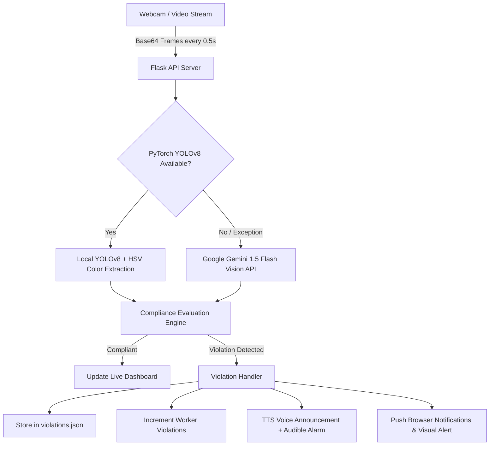

# 🏗️ SafCam - AI Construction Site Safety Monitoring System

[](https://www.python.org/)
[](https://flask.palletsprojects.com/)
[](https://github.com/ultralytics/ultralytics)
[](https://ai.google.dev/)
[](LICENSE)

**SafCam** is a high-performance, real-time computer vision safety monitoring system built for construction sites and industrial workspaces. It uses a **hybrid detection engine** combining local deep learning (**PyTorch YOLOv8**) with cloud-based **Google Gemini 1.5 Flash Vision** fallback to enforce mandatory Personal Protective Equipment (PPE) compliance, including **Safety Helmets (Hard Hats)** and **High-Visibility Safety Vests**.

---

## 📑 Table of Contents

- [Key Features](#-key-features)
- [System Architecture](#-system-architecture)
- [Prerequisites](#-prerequisites)
- [Quick Start Installation](#-quick-start-installation)
- [Configuration](#-configuration)
- [Running SafCam](#-running-safcam)
- [Dashboards & Portals](#-dashboards--portals)
- [Detection Modes & Calibration](#-detection-modes--calibration)
- [API Reference](#-api-reference)
- [Project Structure](#-project-structure)
- [Troubleshooting](#-troubleshooting)
- [License](#-license)

---

## 🎯 Key Features

- ⚡ **Real-Time PPE Detection** – Evaluates live video streams every **0.5 seconds** with low latency.
- 🔄 **Hybrid Detection Architecture**:
  - **Primary**: Local **PyTorch YOLOv8** model for instant, privacy-first, zero-cost, offline-capable PPE analysis.
  - **Fallback**: **Google Gemini 1.5 Flash Vision API** for high-accuracy contextual understanding.
- 🦺 **Dual Safety Gear Verification**:
  - **Safety Helmet / Hard Hat** detection (Yellow, Orange, White, Blue).
  - **High-Visibility Safety Vest** detection (Orange, Yellow, Lime-Green).
- 🔊 **Automated Voice & Audio Alerts**:
  - Offline Text-to-Speech voice warnings using `pyttsx3`.
  - Audible beep tones and browser notification alerts for immediate worker feedback.
- 👷 **Worker Management & Tracking**:
  - Dedicated Manager Portal (`/manager`) to register workers by ID and role.
  - Per-worker violation logging, compliance scoring, and last-seen activity timestamps.
- 📊 **Live Compliance Analytics**:
  - Real-time statistics including total scans, total violations, gear-specific breakdown, and compliance percentage.
- 📸 **Reference Image Capture Tool**:
  - Built-in utility (`capture_references.py`) to capture and calibrate reference items for demo or custom gear scenarios.

---

## 🏗️ System Architecture



---

## 📋 Prerequisites

- **Operating System**: Windows 10/11, macOS, or Linux
- **Python**: Version `3.8` or higher (`3.10+` recommended)
- **Camera**: Standard USB webcam or built-in laptop camera
- **Audio Output**: Speakers or headphones for voice alerts
- **Google Gemini API Key** *(Optional, recommended for fallback mode)*: [Get free API key](https://aistudio.google.com/app/apikey)

---

## 🚀 Quick Start Installation

### 1. Clone or Open the Repository

```bash
git clone https://github.com/your-username/safcam.git
cd safcam
```

### 2. Create and Activate a Virtual Environment

**Windows (PowerShell):**
```powershell
python -m venv .venv
.venv\Scripts\Activate.ps1
```

**Linux / macOS:**
```bash
python3 -m venv .venv
source .venv/bin/activate
```

### 3. Install Required Dependencies

```bash
pip install -r requirements.txt
```

*Key dependencies installed:*
- `flask`, `flask-cors` – Web application framework
- `torch`, `torchvision` – PyTorch deep learning backend
- `ultralytics` – YOLOv8 object detection
- `opencv-python`, `pillow`, `numpy` – Computer vision and image processing
- `pyttsx3` – Offline Text-to-Speech voice engine
- `google-generativeai`, `python-dotenv` – Gemini Vision integration

---

## ⚙️ Configuration

1. **Create Environment File**:
   Copy `.env.example` to `.env`:
   ```bash
   cp .env.example .env
   ```

2. **Configure API Keys in `.env`**:
   ```ini
   # Google Gemini Vision API Key (used as fallback or primary vision engine)
   GEMINI_API_KEY=your_gemini_api_key_here

   # Optional keys for voice or TTS redundancy
   GEMINI_API_KEY_1=your_first_key_here
   GEMINI_API_KEY_2=your_second_key_here

   # Server Environment
   FLASK_ENV=development
   FLASK_DEBUG=True
   ```

---

## 💻 Running SafCam

Start the application server:

```bash
python app.py
```

Upon startup, the console will output:
```text
✅ PyTorch detector initialized successfully
✅ Voice alert system initialized
✅ Worker management system loaded
🚀 SafCam Server Starting...
📊 Dashboard: http://localhost:5000
🔥 Detector: PyTorch (YOLOv8)
🔑 Gemini Fallback: Available
```

---

## 🖥️ Dashboards & Portals

### 1. Live Safety Monitor Dashboard
- **URL**: `http://localhost:5000/`
- **Features**:
  - Live video preview with start/stop monitoring controls.
  - Active detection method badge (PyTorch / Gemini).
  - Real-time statistics: Total Scans, Violations Count, Compliance Rate %.
  - Live Alert Banner with audio chime when violations occur.
  - Real-time violation history log with clear/purge option.

### 2. CCTV Operations & Workforce Manager Portal
- **URL**: `http://localhost:5000/manager` (or `http://localhost:5000/manager.html`)
- **Features**:
  - **Multi-Camera CCTV Operations Grid**: 6 dedicated camera feeds covering all site sectors (Main Gate Check-in, Structural Framework, Heavy Machinery Bay, Excavation Pit, Logistics Depot, Fabrication Bay).
  - **Master & Per-Camera Controls**: "Start All Feeds" / "Stop All Feeds" master buttons plus individual stream toggles.
  - **Zone Safety Protocols & Risk Matrix**: Risk classification (Critical / High / Medium), required PPE checklist per zone, and live personnel distribution.
  - **Site-Wide Emergency PA Broadcast**: Real-time voice announcement broadcast over site speakers (`POST /api/broadcast-alert`).
  - **Workforce Registry**: Register personnel with Role/Classification, Assigned Safety Zone, Emergency Contact, and Safety Clearance badge.
  - **Real-Time Search & Filters**: Instant keyword search by name or ID, role filter, and zone filter.

---

## 🧪 Detection Modes & Calibration

SafCam supports two operational modes:

### A. Production Mode (Real Industrial PPE)
- **Safety Helmet**: Detects standard industrial hard hats (Yellow, Orange, White).
- **Safety Vest**: Detects standard retroreflective high-visibility vests (Neon Yellow, Orange, Lime Green).
- Uses YOLOv8 person bounding boxes with HSV color space filtering.

### B. Demonstration & Testing Mode (Desk Setup)
- If you don't have hard hats at your desk, Gemini Vision mode recognizes:
  - **Cap / Hat** on head $\rightarrow$ maps to Helmet compliance.
  - **ID Card / Lanyard** around neck $\rightarrow$ maps to Vest compliance.

### C. Reference Image Calibration Tool
To calibrate specific caps or lanyards for testing:
```bash
python capture_references.py
```
Follow the interactive webcam prompts to capture reference snapshots into `reference_images/`.

---

## 📡 API Reference

| Method | Endpoint | Description |
|---|---|---|
| `GET` | `/api/health` | Health status, active detector engine (`pytorch`/`gemini`), and voice alert readiness. |
| `POST` | `/api/analyze-frame` | Analyzes a base64 frame payload `{ "image": "<base64>" }` and returns violation details. |
| `GET` | `/api/violations` | Returns complete violation log history. |
| `GET` | `/api/stats` | Returns real-time aggregate statistics (scans, violations, compliance %). |
| `POST` | `/api/clear-violations` | Clears all violation log entries from persistent storage. |
| `GET` | `/api/workers` | Retrieves list of all registered workers and worker stats. |
| `POST` | `/api/workers` | Registers a new worker `{ "name": "...", "employee_id": "...", "role": "..." }`. |
| `DELETE` | `/api/workers/<employee_id>` | Removes a registered worker by Employee ID. |
| `GET` | `/manager` | Serves the Manager Dashboard web interface. |

---

## 📁 Project Structure

```text
safcam/
├── app.py                  # Main Flask application and REST API endpoints
├── detector.py             # PyTorch YOLOv8 detector & HSV color PPE analyzer
├── voice_alerts.py         # Offline pyttsx3 Text-to-Speech & audible alarm system
├── worker_manager.py       # Worker database CRUD operations and statistics
├── capture_references.py   # Webcam utility to capture reference test images
├── index.html              # Main Live Monitor dashboard UI
├── script.js               # WebRTC camera capture and live frontend controller
├── manager.html            # Worker Management dashboard UI
├── manager.js              # Worker management CRUD frontend logic
├── styles.css              # Glassmorphic dark theme design system
├── requirements.txt        # Python dependency manifest
├── yolov8n.pt              # YOLOv8 Nano pre-trained model weights
├── workers.json            # Worker profiles persistent JSON storage
├── violations.json         # Violation logs persistent JSON storage
├── .env.example            # Sample environment variables configuration
├── .gitignore              # Git ignore rules
├── QUICKSTART.md           # Quick start tutorial
├── PYTORCH_SETUP.md        # PyTorch & YOLO installation deep dive
└── VOICE_WORKER_SETUP.md   # Voice alerts and worker setup notes
```

---

## 🔧 Troubleshooting

### 1. PyTorch / YOLOv8 Checkpoint Loading Issue
- **Issue**: `WeightsUnpickler error: Unsupported global ... weights_only`
- **Solution**: SafCam includes an automated compatibility patch for PyTorch 2.6+ in `detector.py`. Ensure you run `python app.py` with the updated files.

### 2. Camera Access Blocked
- Ensure browser permissions allow camera access on `http://localhost:5000`.
- In Chrome, navigate to `chrome://settings/content/camera` and enable permissions.
- Make sure no other program (Zoom, Teams, etc.) is locking the webcam.

### 3. Voice Alerts Not Speaking
- On Windows, verify that system sound is unmuted and the default audio device is configured.
- If running in headless Linux environments, install `espeak`: `sudo apt-get install espeak`.

### 4. GPU Acceleration (CUDA)
- By default, PyTorch runs efficiently on CPU (~0.2–0.4s inference). For dedicated NVIDIA GPUs:
  ```bash
  pip install torch torchvision --index-url https://download.pytorch.org/whl/cu121
  ```

---

## 📄 License

This project is licensed under the **MIT License** - see the [LICENSE](LICENSE) file for details.
